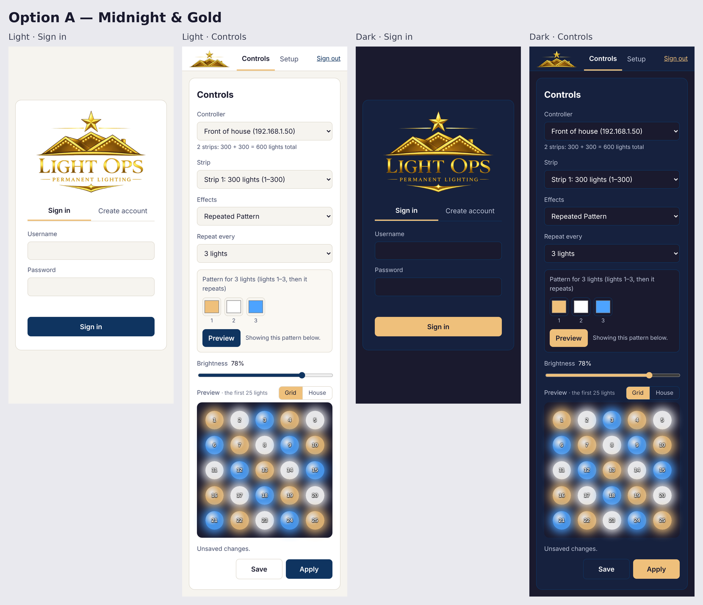
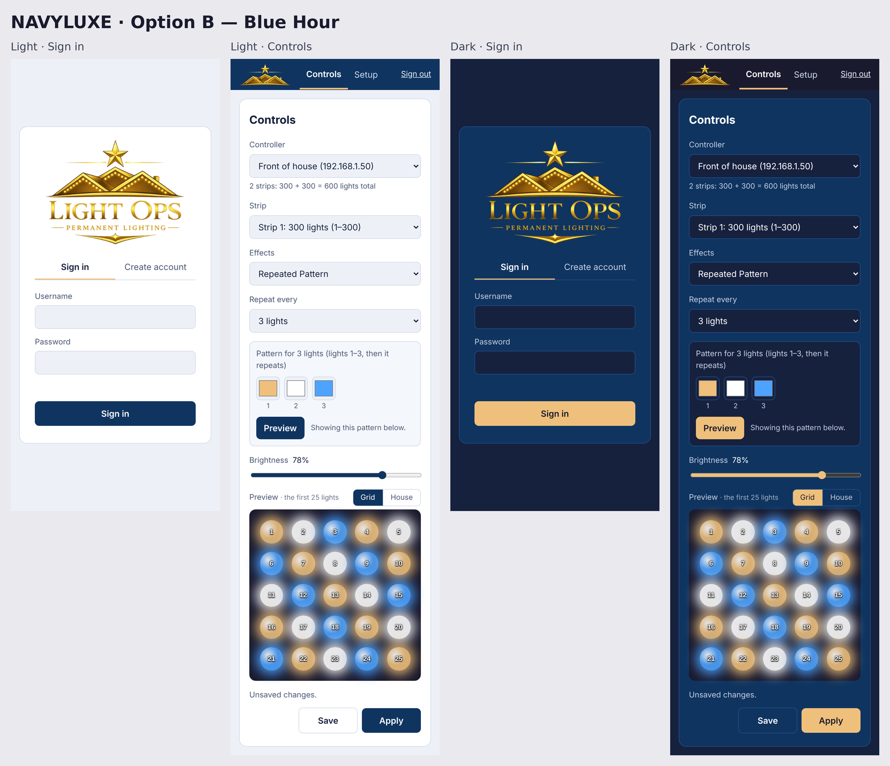
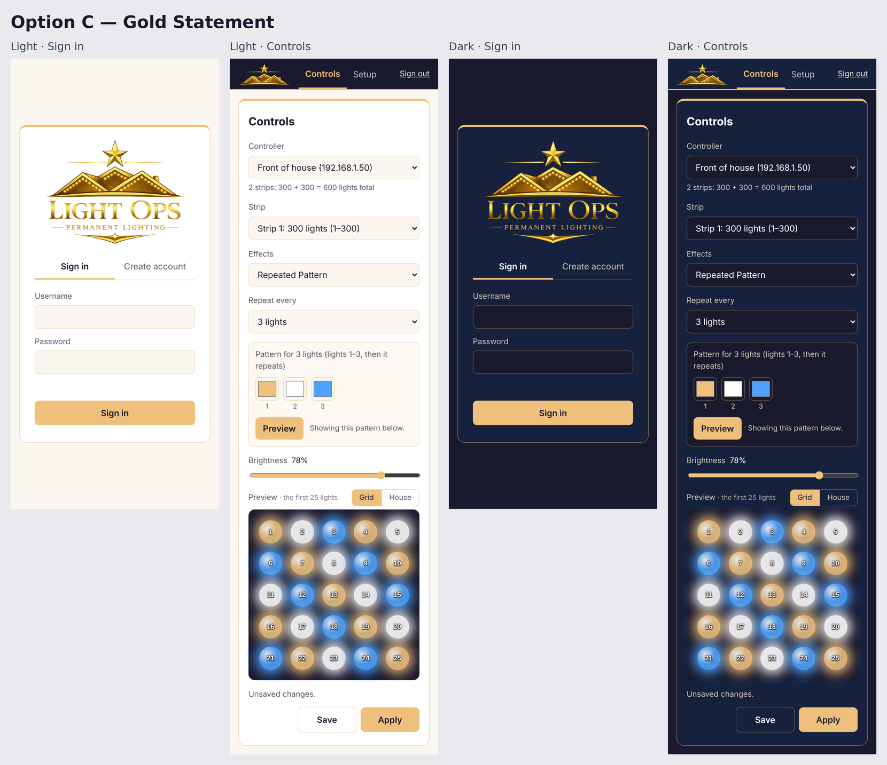
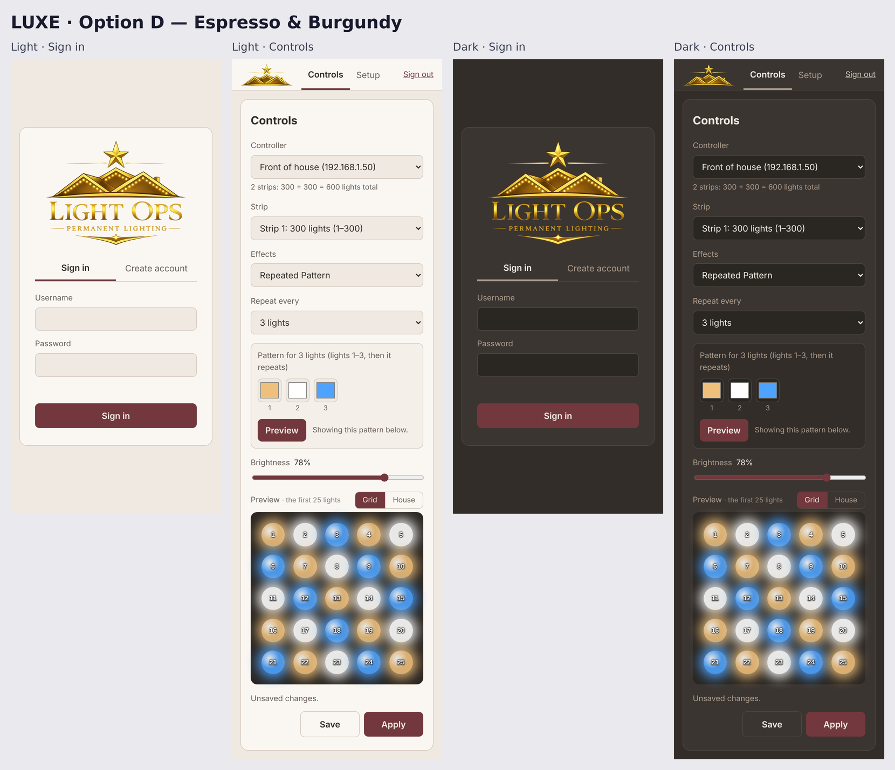
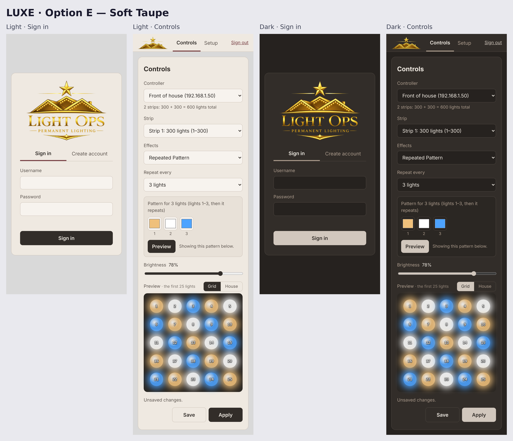
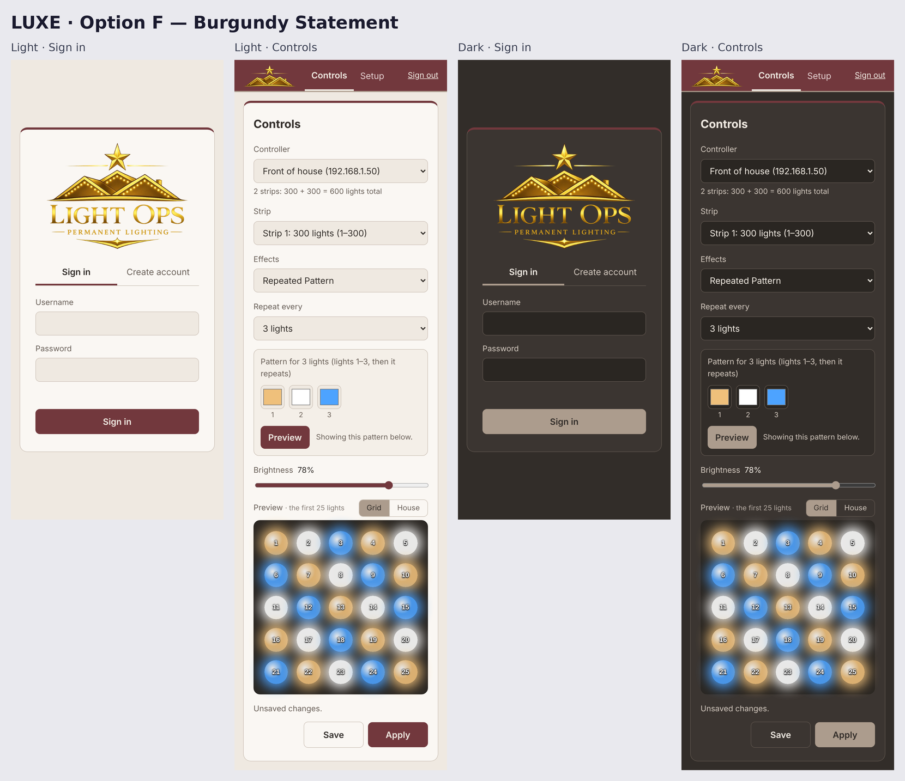
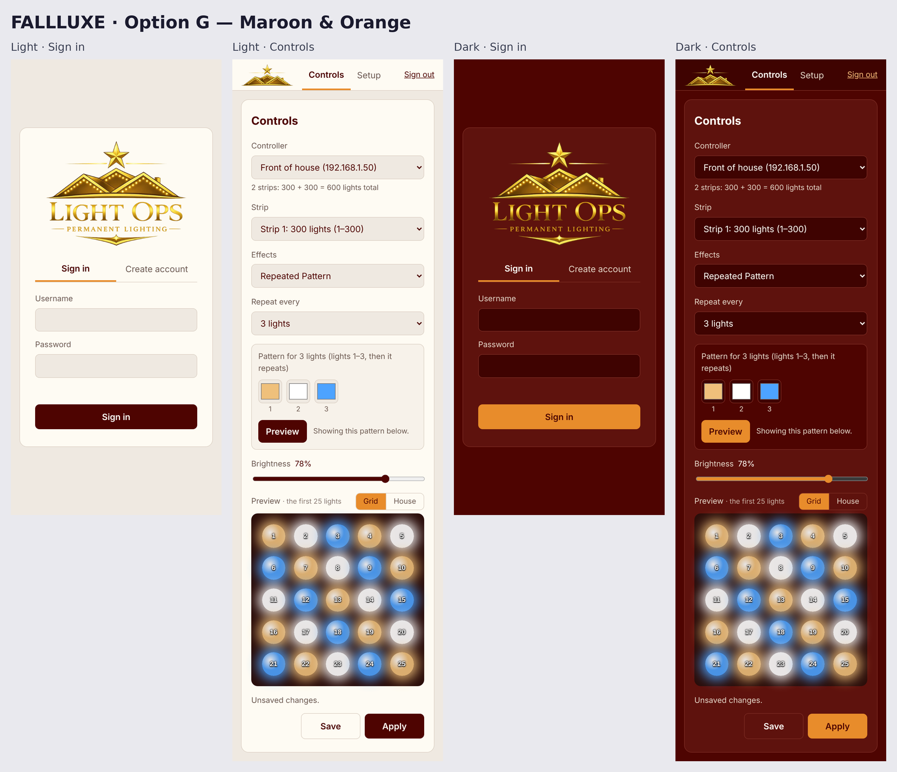
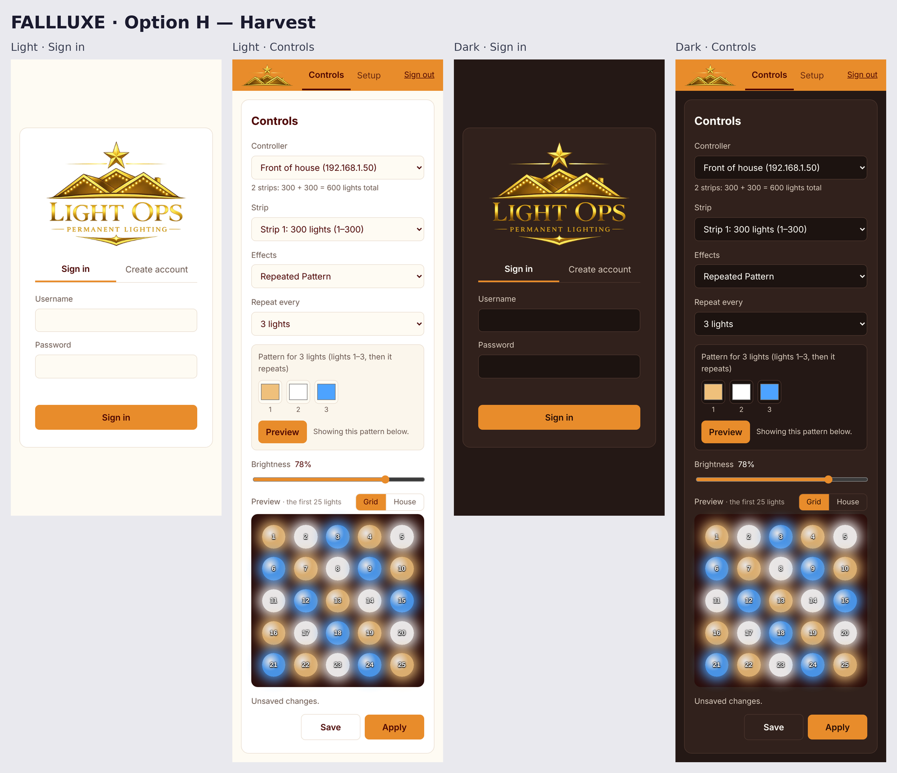
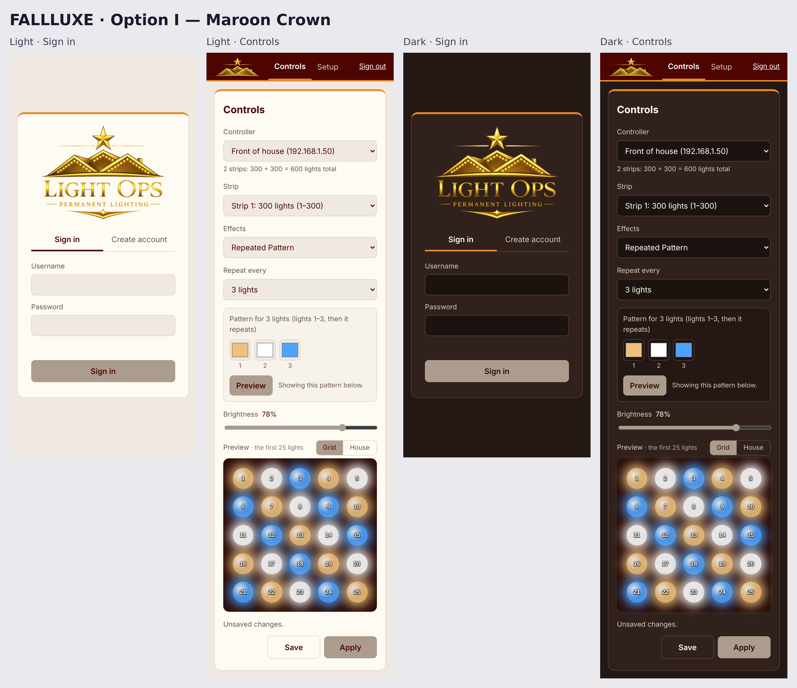

# Theme options (not decided yet)

Nine ways to restyle the app, in three palette families. **None of these is applied to the app.**
They are kept here until a permanent choice is made.

Every option has a **light** and a **dark** version; the app follows the phone/computer's light or
dark setting. In all of them the light preview stays a night scene, and low-contrast colors (gold,
taupe) are never used for small text on light backgrounds.

Each screenshot shows, at phone size: sign-in page (light), Controls tab (light), sign-in page
(dark), Controls tab (dark).

---

## NAVYLUXE (Options A, B, C)

| Color | Hex |
|---|---|
| Darkest navy | `#1a1a2e` |
| Dark navy | `#16213e` |
| Blue | `#0f3460` |
| Gold | `#efc07b` |
| White | `#FFFFFF` |

| | A: Midnight & Gold | B: Blue Hour | C: Gold Statement |
|---|---|---|---|
| Idea | Navy layers, gold for actions | Blue `#0f3460` leads, gold as highlight | Gold-forward, navy header bar in both modes |
| Dark | `#1a1a2e` background, `#16213e` cards, gold buttons | `#16213e` background, `#0f3460` cards, `#1a1a2e` header, gold buttons | `#1a1a2e` background, `#16213e` cards with thin gold borders, gold buttons |
| Light | Warm off-white background, navy buttons, gold tab underline | Pale blue background, `#0f3460` header and buttons | Cream background, navy header, gold buttons with navy text, gold strip on cards |
| Files | [option-a.css](option-a.css) · [option-a.png](option-a.png) | [option-b.css](option-b.css) · [option-b.png](option-b.png) | [option-c.css](option-c.css) · [option-c.png](option-c.png) |

---

## LUXE (Options D, E, F)

| Color | Hex |
|---|---|
| Espresso | `#322D29` |
| Burgundy | `#72383D` |
| Taupe | `#AC9C8D` |
| Light taupe | `#D1C7BD` |
| Grey | `#D9D9D9` |
| Cream | `#EFE9E1` |

| | D: Espresso & Burgundy | E: Soft Taupe | F: Burgundy Statement |
|---|---|---|---|
| Idea | Classic: burgundy for actions | Quiet, minimal neutrals | Burgundy header bar, bolder |
| Light | Cream background, burgundy buttons and tab underline | Grey background, cream cards, espresso buttons, burgundy tab underline and links | Cream background, burgundy header, burgundy buttons, burgundy strip on cards |
| Dark | Espresso background, burgundy buttons | Deep espresso, light-taupe buttons | Espresso with burgundy header, taupe buttons |
| Files | [option-d.css](option-d.css) · [option-d.png](option-d.png) | [option-e.css](option-e.css) · [option-e.png](option-e.png) | [option-f.css](option-f.css) · [option-f.png](option-f.png) |

---

## FALLLUXE (Options G, H, I)

| Color | Hex |
|---|---|
| Orange Grove | `#E88C2B` |
| Calming White | `#FEFBF3` |
| Dark Maroon | `#4E0401` |
| Cream (from LUXE) | `#EFE9E1` |
| Taupe (from LUXE) | `#AC9C8D` |

| | G: Maroon & Orange | H: Harvest | I: Maroon Crown |
|---|---|---|---|
| Idea | Maroon for actions, orange highlights | Orange-forward | Maroon header bar, soft taupe actions |
| Light | Cream background, calming-white cards, maroon buttons and text, orange tab underline | Calming-white background, orange header and buttons (maroon text), maroon links | Cream background, maroon header with orange line, orange strip on cards, taupe buttons |
| Dark | Maroon background, orange buttons | Deep warm brown, orange header and buttons | Deep warm brown, maroon header, taupe buttons |
| Note | | The gold logo has weak contrast on the orange header | |
| Files | [option-g.css](option-g.css) · [option-g.png](option-g.png) | [option-h.css](option-h.css) · [option-h.png](option-h.png) | [option-i.css](option-i.css) · [option-i.png](option-i.png) |

---

## Applying one later

Each `option-*.css` only overrides the app's color variables and a few rules, so it is applied by
loading it **after** `public/styles.css`. To try one locally without changing anything permanent:

1. Copy it into the app, e.g. `cp design/theme-options/option-d.css public/theme.css`
2. In `public/index.html` and `public/home.html`, add after the `styles.css` line:
   `<link rel="stylesheet" href="/theme.css">`

To make the choice permanent, fold the chosen file's values into the `:root` color variables at
the top of `public/styles.css` (and its dark-mode block), so there is one stylesheet.
